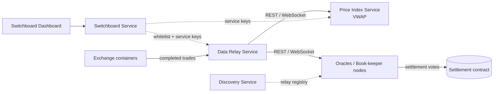

# Data Relay Service

> Go service that relays completed-trade data from exchanges to oracles and a VWAP index over REST and WebSockets, with TLS and Redis.

<p>


</p>

The relay layer of the platform. Exchange containers push completed trades to a Data Relay (DR), and the DR fans that data out to subscribed oracles and the VWAP [price-index-service](https://github.com/warbuxx87/price-index-service) over REST or WebSockets. Relays register themselves with the [discovery service](https://github.com/warbuxx87/dr-discovery-service) so oracles can find them, and they authenticate through the [switchboard](https://github.com/warbuxx87/switch-board-service).

## Where it fits

Part of Alkemi's distributed market-data platform: a set of Go microservices that collect completed trades from exchange containers, relay them to oracles and a VWAP price index, and settle results on-chain.



## How it works

- `cmd/data-relay-service` runs the TLS-enabled Echo server, and `cmd/data-relay-service-dev-client` is a test client.
- `internal/app/data-relay-service/managers` handles subscriber management and fan-out, using Redis for pub/sub state.
- Shared message types come from Alkemi's common message package.
- Errors are reported to Sentry and logs go through logrus.

## Stack

Go, Redis, MySQL, Swagger, Sentry

## Running locally

```bash
cp configs/config.json.example configs/config.json
go run ./cmd/data-relay-service
```

## Credits

Built at Alkemi by Raynaldo Rivera and Curtis Goolsby (2019), as part of the platform I founded and led.

---
<sub>Part of <a href="https://github.com/warbuxx87">Ryan Breen's</a> work · <a href="https://www.linkedin.com/in/breen-ryan/">LinkedIn</a></sub>
